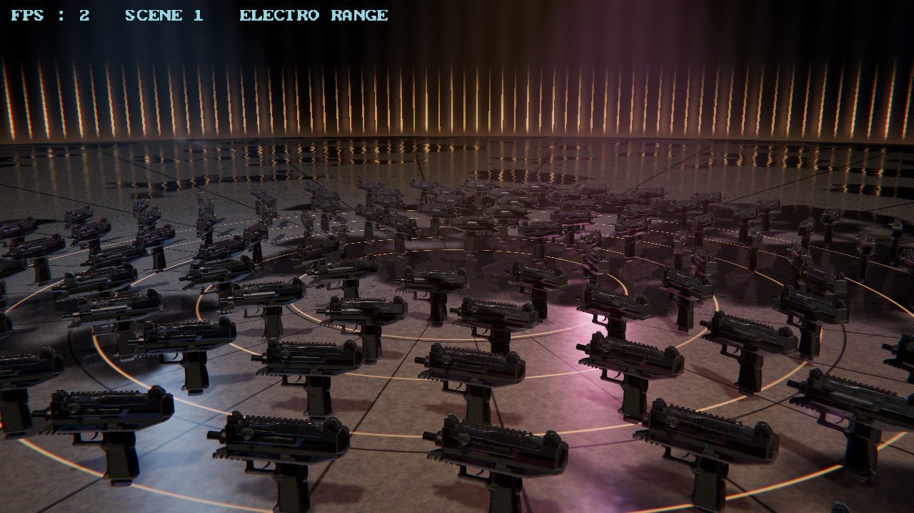
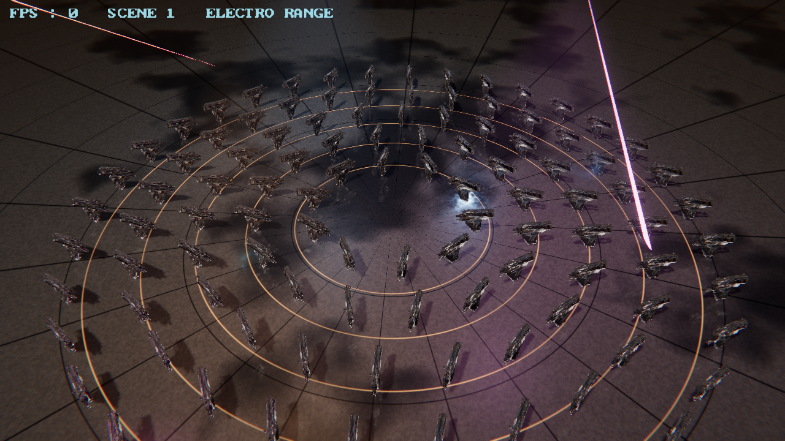
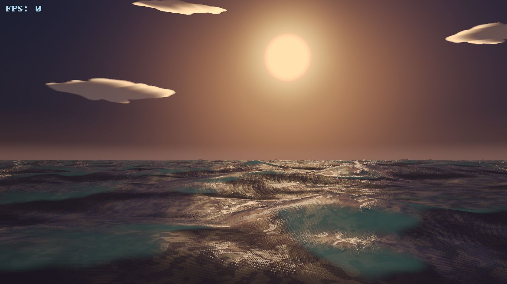
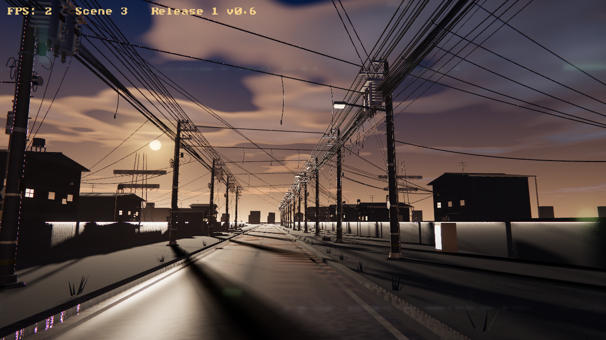
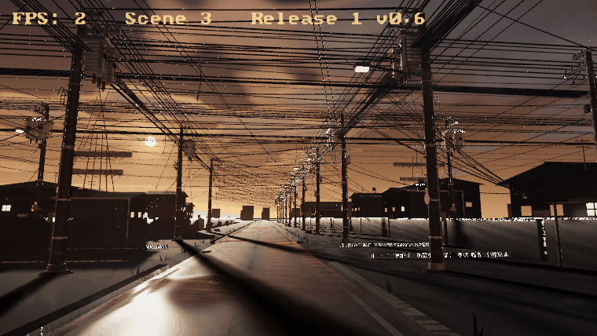

# ElectroBench

**PS : For the Android, PSVITA and PSP versions check here : [ports repo](https://github.com/deadbeef7/ElectroBench-ports)**

ElectroBench is a 60+45+45 second long three-scene benchmark specifically designed to run on old and modern PCs, don't critise it by it using OpenGL 3.3, Even office PCs have low scores at it.
All three scenes use OpenGL 3.3 core, GLSL 3.30, and C++, and make for compilation. It is designed to be a replacement for glmark (even though it is great and I used it before) and maybe 3DMark.

It ships **one** executable that contains **all three** scenes — no second binary, no child process:

All three scenes present at **1280x720 fullscreen**. Pass `--windowed` to run in a window instead;
fullscreen is suppressed automatically whenever `--screenshot` or `--width` is given, so the
headless capture pipeline can still pin the framebuffer exactly.

| Scene | Renderer | Contents |
|---|---|---|
| **Scene 1 — Electro Range** | OpenGL 3.3 core, GLSL 3.30 | **110 UZIs** standing in five rings on a polished, wet concrete carousel in a dark hangar: full PBR from the model's **six maps** (base colour, normal, metallic, height, AO, roughness), shadow-mapped key light, three moving colour-gelled light bars, real **planar reflections** in the slab, HDR bloom and a scripted crane/dolly camera |
| **Scene 2** | OpenGL 3.3 core, pixel-shader workloads | An ocean under volumetric clouds (3DMark2001 SE "Pixel Shader" benchmark recreation) |
| **Scene 3** | OpenGL 3.3 core, analytic shaders | A utility corridor at amber dusk under a **physically-based atmosphere** (Rayleigh + Mie, limb-darkened sun disc, wind-blown cumulus): weathered **concrete** pole shafts carrying the hardware the reference photograph shows — three tiers of pin insulators, transformer, cut-out fuses, step bolts, guy wires into buried anchors — wrapped in a **dense web of 16 thin slack telecom cables per bay** plus **hanging slack coils and service loops**, two lattice cell masts for scale, a **damp asphalt road with cast concrete kerbs that mirrors the sunset**, houses with lit windows. 4x MSAA |

# System requirements : 

CPU : Any single core CPU @ 500 MHz or more.

RAM : 128MB+

GPU : Any GPU with OpenGL 3.3 core support (2010 onwards).

OS : Any.


# Screenshots

Scene 1, the electro range: 110 UZIs standing in five rings on a wet, polished carousel in a dark hangar. The wall's amber light slots mirror perfectly in the slab, thin inlay rings run between the gun rings, and the guns are shaded entirely from their six texture maps under the moving key light and the three colour-gelled bars overhead:



Looking down the rings — every gun casts its own shadow from the moving key light, and the pool of light from each bar falls across the slab:



The dusk ocean scene — long cloud banks with sunward silver linings, two thin cirrus wisps riding high above the sun, a narrow orange glitter path down the middle of the sea, dark blue-purple water either side, raised swell banks:



The power-line corridor — an orange dusk under a real atmosphere (Rayleigh sky, a tight limb-darkened sun disc sitting on the haze band, wind-blown cumulus with sunward silver linings). The camera aims at the **top** of the pole, because that is the subject: concrete shafts, three tiers of pin insulators, transformers and cut-outs, a **dense web of thin slack telecom cable** strung between the same two poles at a dozen heights, coils of spare cable hung off the brackets, and lattice transmission pylons standing behind the line. Below it, cast concrete kerbs and a damp road mirroring the sunset:



**In motion - but very slow** — the auto-dolly walking the corridor (four positions down the run): the cable web sweeping overhead pole after pole, slack coils swinging past, guy wires pulling into their anchor blocks, and the telecom bundles peeling off toward the eaves:



# How to build ?

Dependencies : `make`, `g++`, SDL2, GLEW, GLU (+ dev headers). On Debian/Ubuntu that is
`libsdl2-dev libglew-dev libglu1-mesa-dev`; on Windows use MSYS2 (`pacman -S mingw-w64-x86_64-{gcc,SDL2,glew} make`); on macOS `brew install sdl2 glew` (you may need `brew install make` for a GNU make).

```sh
make            # builds the single ElectroBench binary (all three scenes linked in)
make run        # builds it and runs it
```

The one binary lands in `build/` :

```sh
./build/ElectroBench          # Linux / macOS
./build/ElectroBench.exe      # Windows (MSYS2)
```

## Static build

Pass `STATIC=1` to link everything statically (`-static -static-libgcc -static-libstdc++` + static
dependency archives) — handy for dropping a single exe on old machines:

```sh
make STATIC=1            # -> build/ElectroBench-static(.exe)
```

This requires the **static archives** of every dependency (e.g. MSYS2's `mingw-w64-x86_64-SDL2` ships
`libSDL2.a` already; on Linux you need the `.a` variants of SDL2/GLEW/GLU installed). On Windows the
static build also defines `GLEW_STATIC` and uses the static GLEW archive, so its link line is
`-static-libgcc -static-libstdc++ -lopengl32 -lglu32 -lSDL2main -lSDL2 -mwindows` (plus the
`pkg-config --static` dependency flags) — no DLLs are needed next to the exe. The static build keeps
its objects under `build/static/`, separate from the normal DLL-linked objects.

# Scene 1 — the Electro Range (110 UZIs)

Renders **110 UZIs** standing in five concentric rings on a polished concrete carousel inside a dark
hangar, on **OpenGL 3.3 core**. The guns are the only assets in the scene and the only textures it
uses: all six of the model's maps are used for what they are — base colour (sRGB), tangent-space
normal, metallic, height (parallax), ambient occlusion and roughness — so the surface detail is what
the frame is built around.

The carousel turns slowly under three colour-gelled light bars, with a shadow-mapped key light that
orbits on its own, wet patches on the slab that mirror the wall's amber slots and the guns through a
real half-resolution **planar reflection pass**, thin glowing inlay rings running between the gun
rings, HDR bloom and the shared ACES composite. Every frame is lit, shadowed, reflected and graded
by hand-written GLSL 3.30; there is no fixed-function code left in the scene.

Controls : the camera is a scripted crane/dolly — a low establishing move, a rising orbit, a high
reveal, then a dive back onto the rings; automatic from launch, `ESC` quits. The FPS counter is a
true frame-count average (SDL performance counter, every frame accounted) — the on-screen value is a
smoothed window, the final score uses **all** frames of the run.

# Scene 2

**Scene 2** lives in the same ElectroBench binary and is written in **OpenGL 3.3 core**.
It pushes a heavy, realistic ocean workload, high-resolution environment reflections, a dense displaced ocean mesh, and a real volumetric
light-transport model for the clouds. It is heavy **on purpose**: the goal is to push old and new
hardware alike, so low single-digit FPS on a low-end machine means the workload is doing its job.

Controls : the fly-over camera is automatic from launch; `ESC` quits.

# Scene 3

**Scene 3** lives in the same ElectroBench binary and is also **OpenGL 3.3 core**. The
utility corridor: warm gravel under an amber dusk, two lines of steel poles marching to the
horizon, and a wall of wires over your head.

- `--screenshot FILE --shot-time S` writes a frame straight out of the
  framebuffer, before the buffer swap. This is what the committed screenshots in
  `docs/screenshots/` were made with, they generate PPM files.
- `--screenshot FILE --shot-times 6,20,38` writes several frames in one run.

Headless visual-test flags (used to verify the render output in CI-like environments):

```sh
./build/ElectroBench --og-only   --screenshot /tmp/shot.ppm --shot-time 3
./build/ElectroBench --scene-only --width 960 --screenshot /tmp/shot.ppm --shot-times 6,20,38
./build/ElectroBench --pole-only  --width 960 --screenshot /tmp/shot.ppm --shot-times 2,9
```

# How the score is calculated ?

All scenes use the same formula, computed from the **average FPS over the whole run**:

```
score = fps² × 2
```

It is linear in nothing: twice the frames means twice the score, twice the load means a quarter of
it — a fair curve from office PCs to gaming rigs. The binary prints
`Time / Average FPS / Score` at the end, and the OG scene also shows live FPS + score in its HUD.

# The results screen

When a scene's 45/60 second run ends, **the benchmark clears the window and prints that scene's
score on screen**.

```sh
Benchmark Results - Time : 45.0s, Average FPS : 12.4, Score : 308
```

# One executable, three scenes

`build/ElectroBench` is the **only** binary, and it contains all three scenes. It runs the 60-second
Electro Range first, then the dusk ocean and the power lines on the same session, and
the final results screen shows **per-scene scores and the average of the three**. All three scenes need
an OpenGL 3.3 core context; on a device without one the binary says so and exits instead of showing
a broken frame.

Scene selection flags: `--og-only` runs just the Electro Range,
`--scene-only` runs just the ocean scene,
`--pole-only` runs just the power-line scene.

# Windows (MSYS2)

On Windows the easiest route is [MSYS2](https://www.msys2.org/), which provides gcc, cmake and prebuilt SDL2/GLEW/GLU packages. The single binary builds and runs unmodified.

**1. Install MSYS2** from [msys2.org](https://www.msys2.org/) to the default `C:\msys64`.

**2. Clone the repo then run:**

```sh
pacman -S mingw-w64-x86_64-toolchain mingw-w64-x86_64-{make,SDL2,glew}
make
```
(press enter to the first question then press "y" then enter) 

All three scenes are linked into that one binary: `src/scene1.cxx`, `src/scene2.cxx` and
`src/scene4.cxx` are scene modules (they have no `main()` of their own) that `src/main.cxx` hands the
same SDL session to. For
the static build, prefer
`make STATIC=1`: it passes `-DGLEW_STATIC`, uses `pkg-config --static`, and keeps the static object
files separate from the normal build. If invoking `g++` directly, use the same define and static
GLEW archive consistently; do not compile with the DLL-import GLEW header and then link
`libglew32.a`.

# Contributions

Contributions are welcome, just post a PR / issue.

# Donating

Send me in my email or post an issue : ayoubprogramming96@outlook.com
